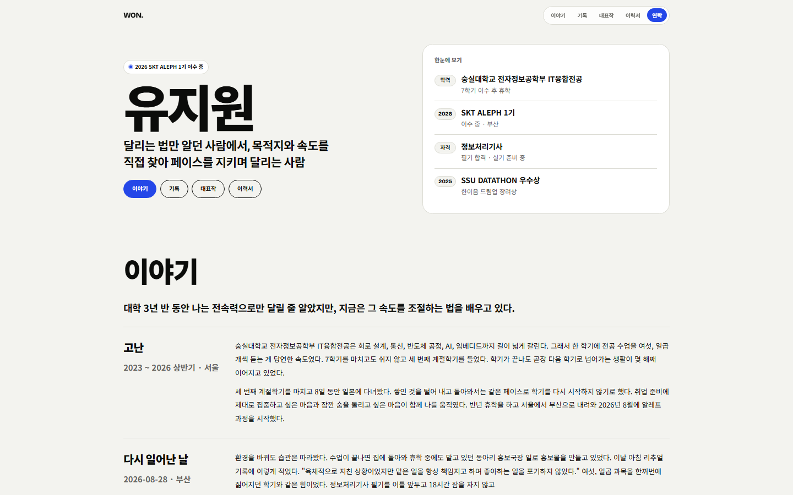
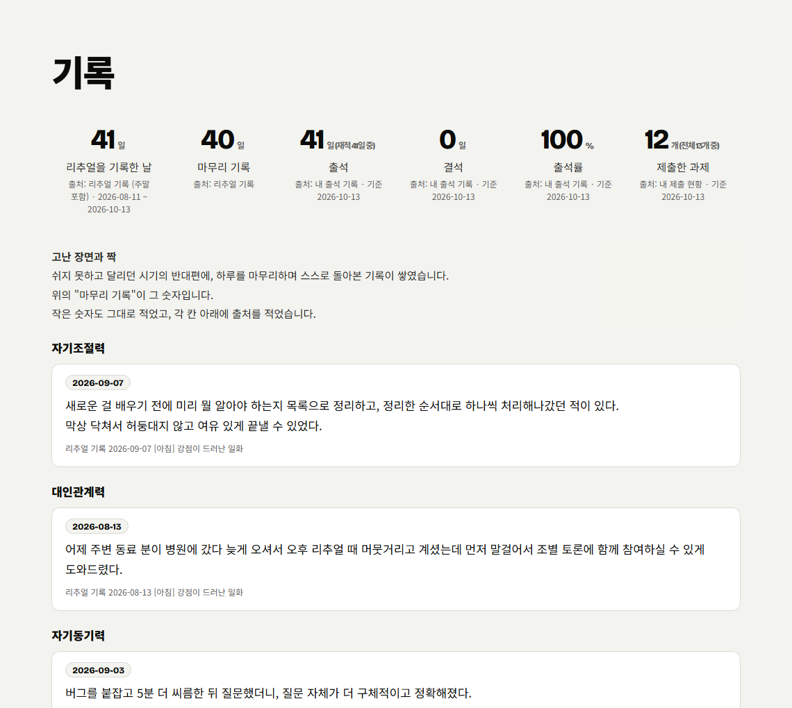
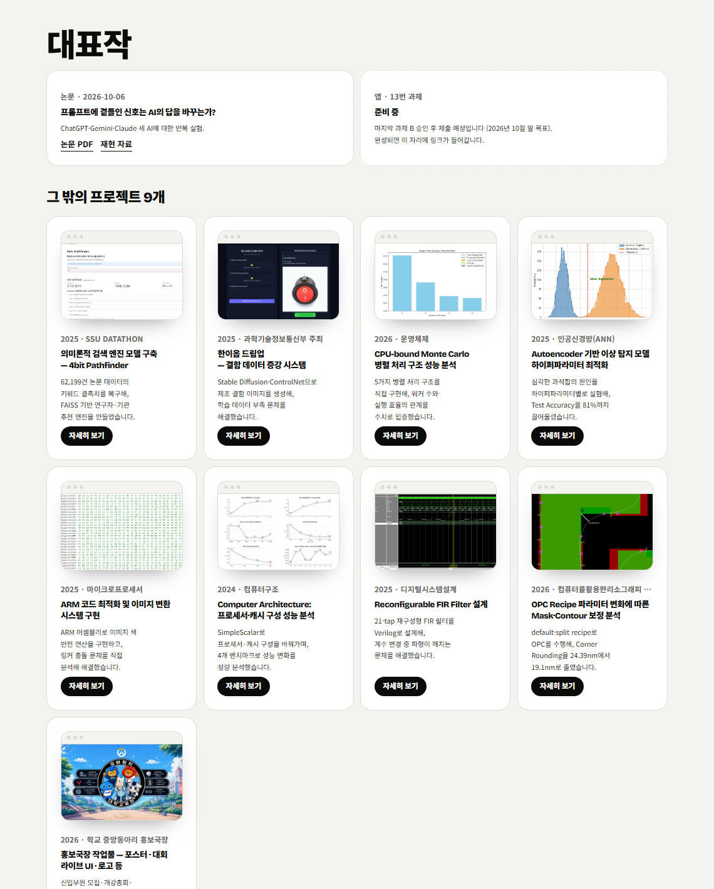
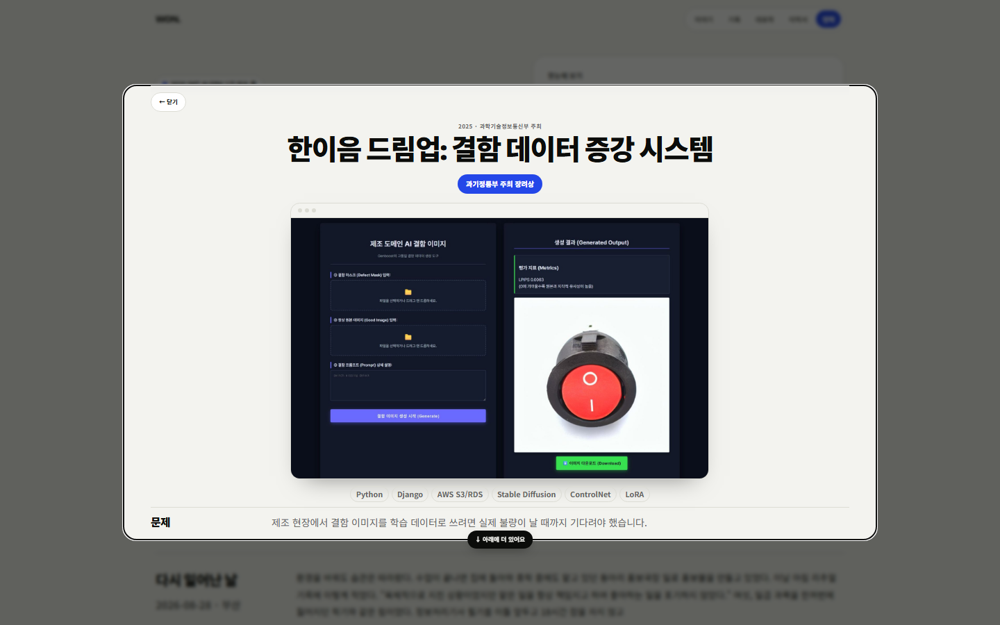
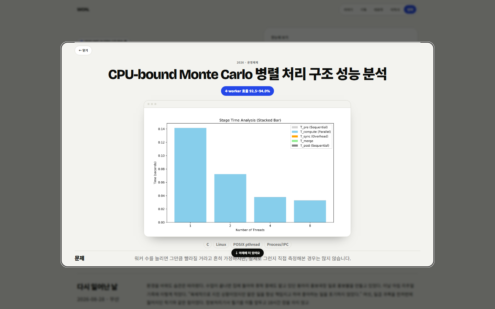
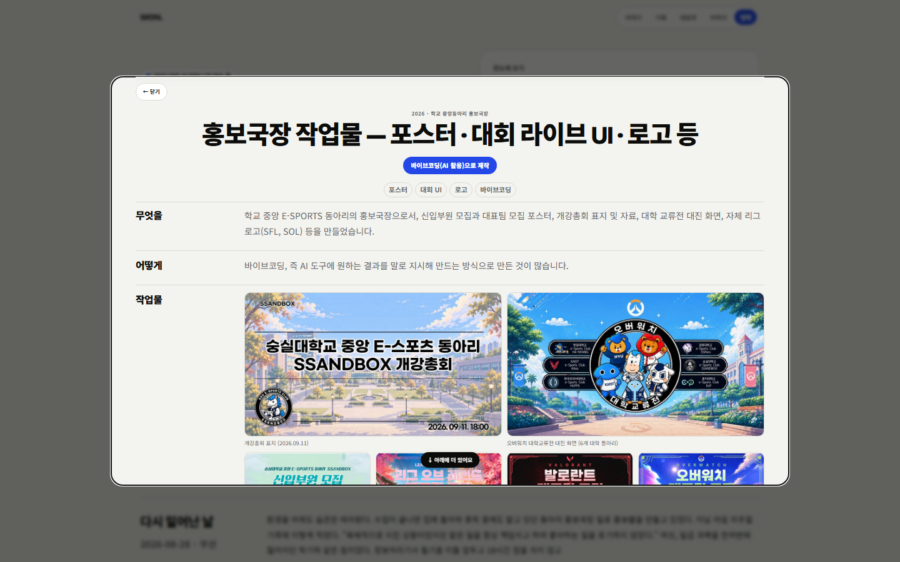
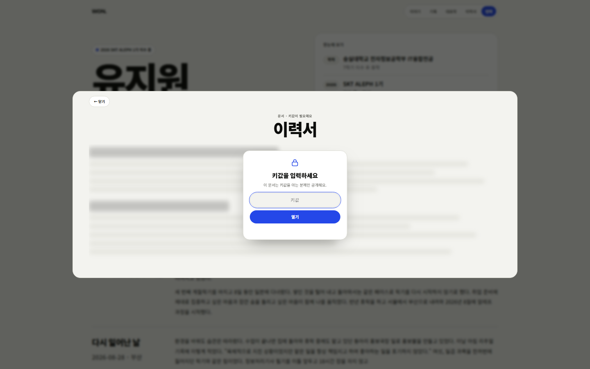
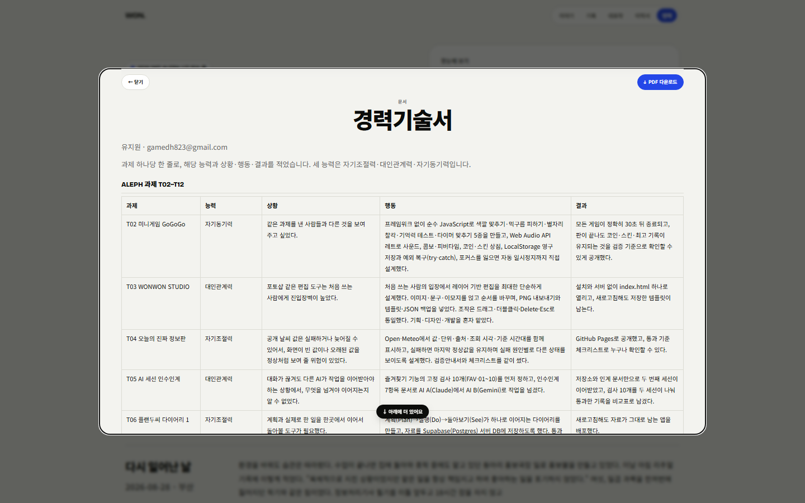
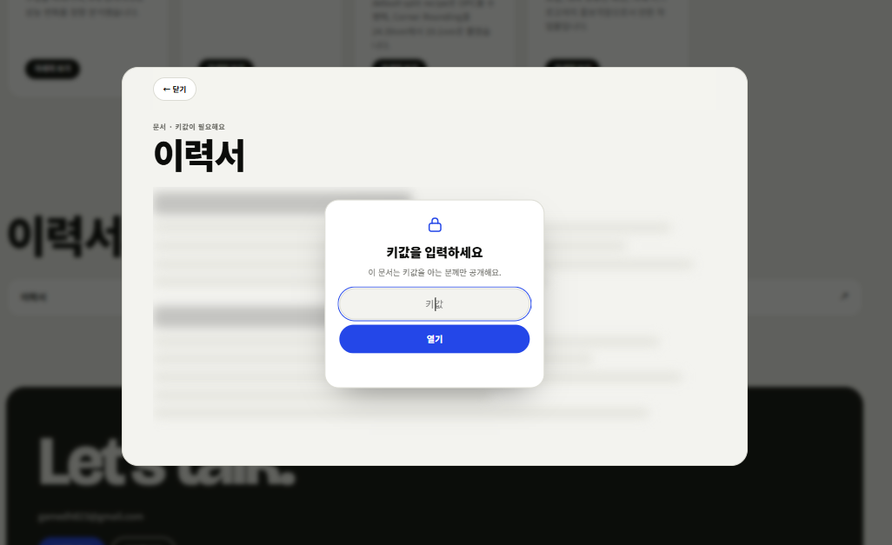
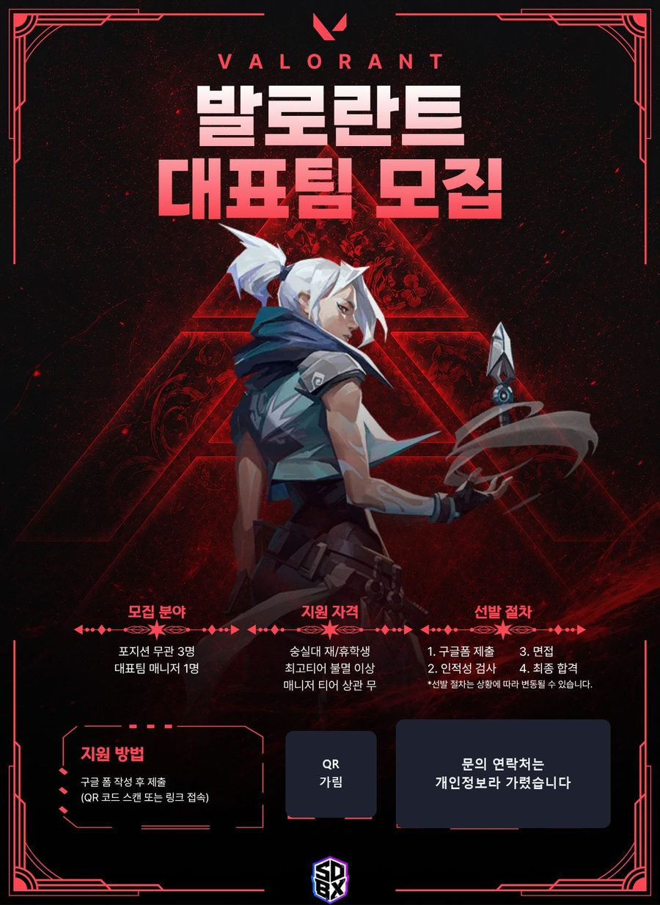

# 유지원 · 이야기와 기록

**공개 사이트**: https://gamedh823-cmd.github.io/T12/

고난에서 시작해 다시 일어난 날을 지나 더 나아진 지금까지의 이야기, 13주 기록에서 센 숫자, 대표작(논문·앱 자리), 프로젝트와 문서를 한 페이지에 담은 소개 사이트입니다. 마지막 과제 A의 결과물이며, 이 사이트의 숫자와 근거 문단은 별도의 스크립트(갱신 장치)로 다시 만들 수 있습니다.

처음 오신 분은 3분 안에 이렇게 읽으시면 됩니다.

1. 첫 화면에서 이름과 한 줄 소개를 읽는다.
2. "이야기"에서 날짜가 있는 장면(고난 → 2026-08-28 → 세 능력 → 지금)을 읽는다.
3. "기록"에서 기록의 숫자와 출처를 확인한다.
4. "대표작"에서 논문과 프로젝트를 눌러 열어 본다.

## 목차

- [구성](#구성)
- [화면 미리보기](#화면-미리보기)
- [기능](#기능)
- [창 안에 창: 프로젝트 창과 문서 창](#창-안에-창-프로젝트-창과-문서-창)
- [확인 방법](#확인-방법)
- [이력서·자기소개서 열람](#이력서자기소개서-열람)
- [민감한 정보는 이렇게 처리했습니다](#민감한-정보는-이렇게-처리했습니다)
- [숫자와 문단 후보를 다시 만드는 장치](#숫자와-문단-후보를-다시-만드는-장치)
- [만든 방법과 AI 사용](#만든-방법과-ai-사용)
- [파일 구조](#파일-구조)

## 구성

| 구역 | 내용 |
|---|---|
| 첫 화면 | 이름, 한 줄 소개, 이야기·기록·대표작·이력서로 가는 버튼, "한눈에 보기" 카드 |
| 이야기 | 고난 → 다시 일어난 날 → 세 능력(자기동기력·자기조절력·대인관계력) → 지금. 장면마다 날짜가 있음 |
| 기록 | 리추얼 기록에서 센 숫자. 칸마다 출처를 적었고, 고난 장면과 짝지은 설명과 승인한 근거 문단이 이어짐 |
| 대표작 | 10번 논문(PDF·재현 자료), 13번 앱 자리(준비 중), 그 밖의 프로젝트 9개(눌러서 창으로 열람) |
| 이력서와 문서 | 경력기술서(공개), 이력서·자기소개서(키값 필요) |

프로젝트와 문서는 새 페이지로 이동하지 않고 같은 화면 위의 창으로 열립니다. 창은 닫기 버튼, 바깥쪽 클릭, `Esc` 키로 닫히고, 내용이 길면 창 안에서만 스크롤됩니다.

## 화면 미리보기



| 기록 구역 | 대표작 구역 |
|---|---|
|  |  |
| 숫자마다 칸 아래에 출처와 기준일을 적었고, 능력별 문단에는 날짜와 출처가 붙어 있습니다. | 프로젝트 카드는 브라우저 창 모양 안에 화면을 담았고, 눌러서 창으로 엽니다. |

## 기능

| 기능 | 어떻게 동작하나 |
|---|---|
| 구역 이동 | 상단 메뉴(이야기·기록·대표작·이력서·연락)를 누르면 해당 구역으로 부드럽게 이동. 모션 줄이기 설정을 켠 사용자에게는 애니메이션 없이 이동 |
| 기본 배율 | 900px 이상의 넓은 화면에서는 처음 열었을 때 브라우저 배율 67% 기준의 크기로 보임. 좁은 화면(휴대폰·태블릿)은 배율을 바꾸지 않음 |
| 프로젝트 창 | 프로젝트 카드를 누르거나 키보드로 `Enter`·`Space`를 누르면 같은 화면 위에 창이 열림. 새 페이지로 이동하지 않음 |
| 문서 창 | 경력기술서는 바로, 이력서·자기소개서는 키값을 넣어야 열림. 열린 문서는 창 안에서 PDF로 내려받기 |
| 이메일 복사 | "이메일 복사" 버튼을 누르면 클립보드에 복사되고 버튼이 1.8초 동안 "복사됨"으로 바뀜 |
| 라이트·다크 | 기기의 화면 모드를 따라 자동으로 바뀜 |
| 반응형 | 900px, 700px, 560px 기준으로 열 수와 창 크기, 여백이 바뀜 |

## 창 안에 창: 프로젝트 창과 문서 창

대표작 카드와 이력서 항목은 페이지를 이동하지 않고 같은 화면 위의 창(dialog)으로 열립니다. 창 뒤의 본문은 흐리게 가려지고, 창이 열려 있는 동안 뒤쪽 화면은 스크롤되지 않습니다.

### 프로젝트 창



| 창의 부분 | 내용 |
|---|---|
| 맨 위 | `← 닫기` 버튼. 문서 창에서는 오른쪽에 `PDF 다운로드` 버튼이 함께 나옴 |
| 머리말 | 연도·주최(작은 글씨), 프로젝트 이름, 결과 배지(예: "과기정통부 주최 장려상") |
| 화면 | 카드의 화면 이미지를 브라우저 창 모양 틀에 담아 크게 보여 줌 |
| 태그 | 사용한 기술 칩 |
| 본문 | 문제 → 나의 역할 → 구현 방법 → 문제 해결 과정 → 결과 → 증빙 자료 순서의 내용 |
| 아래 안내 | 내용이 더 있으면 창 아래에 "↓ 아래에 더 있어요" 표시. 끝까지 내리면 사라짐 |

창은 `← 닫기` 버튼, 창 바깥 클릭, `Esc` 키 중 어느 것으로든 닫히고, 내용이 길면 창 안에서만 스크롤됩니다.

| 그래프가 있는 프로젝트 | 작업물이 많은 프로젝트 |
|---|---|
|  |  |
| 운영체제 프로젝트: Worker 수에 따른 실행 시간 그래프 | 동아리 홍보국장 작업물: 포스터·로고·대회 화면을 갤러리로 배치 (개인정보는 가림 처리) |

### 프로젝트별로 내가 맡은 일

각 프로젝트 창의 "나의 역할"은 아래와 같고, 함께한 팀원의 이름은 적지 않았습니다.

| 프로젝트 | 내가 맡은 일 |
|---|---|
| 의미론적 검색 엔진 (SSU DATATHON) | 팀장의 역할 수행, 데이터 전처리부터 모델링 및 최적화까지의 파트 |
| 한이음 드림업 | 전처리 파트, AI 모델 실험, 요구사항 정의서·보고서 등의 문서 작업 |
| Monte Carlo 병렬 처리 (운영체제) | 중간 발표 전담, deterministic seed 계산 구조·checksum 검증 체계 정립, workload 조건과 평가 지표 명시, 수행일지 작성, 1.2억 trial 규모의 strong scaling·CPU utilization 실험 실행과 Speedup·Efficiency·CPU% 그래프 시각화, 4-worker 92.5~94.0% 효율과 8-worker 효율 감소 비교 분석 |
| Autoencoder 이상 탐지 (ANN) | Layer/Node, Epoch, Batch Size·Learning Rate, Optimizer·Activation Function, Loss Function을 하나씩 바꿔 비교하는 하이퍼파라미터 최적화 실험 |
| ARM 이미지 변환 (마이크로프로세서) | Subproject #2 색 반전(negative) 연산(R/G/B를 255에서 빼는 어셈블리 함수) 작성, 파트 보고서, 약 70쪽 발표 자료 제작 |
| 프로세서·캐시 구성 분석 (컴퓨터구조) | SimpleScalar 실험 설계와 수행, 4개 벤치마크 시뮬레이션과 결과 분석 |
| Reconfigurable FIR Filter (디지털시스템설계) | 기본 Verilog 코드 작성, Waveform 확인, 보고서 작성 |
| OPC Recipe 분석 (리소그래피 PBL) | 6인 팀에서 default·split recipe로 OPC 수행, Contour simulation 결과 비교 실험 |
| 홍보국장 작업물 | 동아리 홍보국장으로서 포스터·개강총회 표지·대회 화면·리그 로고 제작(바이브코딩) |

### 문서 창

| 키값이 필요한 문서 | 바로 열리는 문서 |
|---|---|
|  |  |
| 이력서·자기소개서: 본문이 흐리게 가려진 채 키값 입력 창이 먼저 뜸. 틀리면 "키값이 맞지 않아요" | 경력기술서: 과제마다 능력·상황·행동·결과를 표로 정리. 오른쪽 위에서 PDF 다운로드 |

## 확인 방법

시크릿 창에서 열어도 로그인이나 설치 없이 보입니다. 키값이 필요한 것은 이력서와 자기소개서뿐입니다.

| 확인할 것 | 어디에 |
|---|---|
| 이름과 "…한 사람"으로 끝나는 한 줄 소개 | 첫 화면 |
| 날짜가 있는 장면 | 이야기 구역 (2026-08-28, 09-03, 09-07, 08-12 등) |
| 세 능력이 각각 장면과 함께 나오는 곳 | 이야기 구역의 자기동기력·자기조절력·대인관계력 |
| 숫자와 출처 | 기록 구역 (칸 아래에 "출처: 리추얼 기록 …") |
| 10번 논문, 13번 앱 자리 | 대표작 구역 |
| 경력기술서(과제마다 능력·상황·행동·결과) | 이력서와 문서 구역 |

## 이력서·자기소개서 열람

이력서와 자기소개서는 키값을 입력해야 열립니다. 키값은 이 저장소에 적지 않았고, 제출문에 따로 적었습니다. 같은 문서는 비밀번호 없이 열리는 PDF로도 제출했습니다.

## 민감한 정보는 이렇게 처리했습니다

이 사이트는 실제 지원에 쓰는 공개 페이지라서, 다른 사람의 실명과 연락처, 내 문서의 열람 범위를 따로 관리했습니다.

### 1. 이력서·자기소개서는 키값이 있어야 열립니다

문서를 누르면 내용이 블러로 가려진 채 "키값을 입력하세요" 창이 먼저 뜹니다. 키값을 넣기 전에는 글자도, PDF 다운로드 버튼도 보이지 않습니다.



- 화면에서만 가린 것이 아니라 **문서 자체를 암호화**했습니다. 저장소에는 암호화된 파일(`docs/*.lock.json`)만 있고 평문 PDF는 없습니다.
- 암호화 방식은 AES-256-GCM이고, 키는 입력한 키값에서 PBKDF2-SHA256(250,000회)로 만듭니다. 복호화는 방문자의 브라우저에서만 일어납니다.
- 키값이 틀리면 "키값이 맞지 않아요"라고 알리고 문서는 열리지 않습니다.
- 키값을 입력해 열면 그때서야 문서 본문과 "PDF 다운로드" 버튼이 나옵니다.

### 2. 포스터와 화면 속 이름·전화번호는 가려서 올렸습니다

동아리 홍보국장으로서 만든 포스터에는 회장의 실명과 전화번호, 인스타그램 아이디가 들어 있었습니다. 원본은 올리지 않고, 해당 부분을 덮은 이미지만 올렸습니다.

| 대표팀 모집 포스터 |
|---|
|  |
| 문의 박스(실명·전화번호·인스타그램)를 "문의 연락처는 개인정보라 가렸습니다"로 덮음 |

- 이름이나 번호가 들어 있어 가려야 하는 다른 자료(이용수칙, 대회 팀 소개 화면 등)는 아예 올리지 않았습니다.
- 올리기 전과 후에 저장소 전체에서 전화번호 형태, 해당 이름, 인스타그램 아이디를 검색해 남아 있지 않은지 확인했습니다.

### 3. 프로젝트 소개에는 함께한 팀원의 이름을 쓰지 않았습니다

팀으로 한 프로젝트(컴퓨터구조, 디지털시스템설계 등)의 "나의 역할"에는 팀원 이름이 적혀 있던 문장이 있었습니다. 팀원 이름을 모두 빼고 **내가 맡은 일만** 남겼고, 저장소 기록에서도 이름이 들어 있던 이전 내용을 지웠습니다.

### 4. 리추얼 기록에는 동료 이름을 넣지 않았습니다

갱신 장치의 입력(`ritual.txt`)에는 **내가 쓴 칸**(내 강점, 강점이 드러난 일화 등)만 남기고, 동료가 말해 준 장점과 감사 칸은 처음부터 뺐습니다. 본문에 남은 이름 표시는 "동료"로 바꿨습니다.

### 5. 연락 수단은 하나만 공개합니다

공개 연락처는 이메일 하나(gamedh823@gmail.com)뿐입니다. 이 저장소의 커밋 작성자는 GitHub 가림 주소(noreply)로 설정해, 다른 이메일이 기록에 남지 않게 했습니다.

### 6. 평문 문서와 이름이 기록에 남지 않게 했습니다

문서를 암호화하기 전에 올렸던 평문 PDF와, 팀원 이름이 들어 있던 이전 내용이 커밋 기록에 남지 않도록 저장소의 기록을 새로 만들어 올렸습니다.

### 7. AI로 만든 작업은 그렇게 밝혔습니다

동아리 포스터·로고·대회 화면은 AI 도구에 지시해 만든 것이 많아서(바이브코딩), 프로젝트 창에 그대로 적었습니다.

## 숫자와 문단 후보를 다시 만드는 장치

`site-updater/`(별도 ZIP으로 제출)는 새 리추얼 기록을 넣고 `python build.py`를 한 번 돌리면 숫자를 다시 세고 능력별 문단 후보를 날짜·출처와 함께 뽑아 줍니다.

- AI를 부르지 않는 규칙 기반 스크립트라 같은 입력이면 항상 같은 결과가 나옵니다. `python check_twice.py`로 두 번 돌려 결과 파일의 해시가 같은지 확인할 수 있습니다.
- 후보에는 날짜, 출처(어느 날 어느 항목인지), 근거 키워드가 붙습니다.
- 내가 승인한 후보만 사이트에 들어갑니다.
- 설치할 패키지가 없고(Python 3.10 이상), API 키나 비밀값을 쓰지 않습니다.
- 돌리는 방법 세 단계는 ZIP 안의 README에 있습니다.

## 만든 방법과 AI 사용

- 디자인은 기존 개인 포트폴리오(https://gamedh823-cmd.github.io/portfolio/)의 구성요소를 가져와 강조색만 코발트 블루로 바꿨고, 구성은 이 과제에 맞게 새로 짰습니다.
- 사이트 틀과 코드, 갱신 장치, 문서 PDF는 AI의 도움으로 만들었고, 한 줄 소개·이야기·문장 선택·승인한 근거 문단·공개 범위는 직접 판단했습니다.
- 순수 HTML·CSS·JavaScript로 만든 정적 페이지입니다(프레임워크 없음). 문서 잠금은 브라우저의 WebCrypto를 씁니다.

## 파일 구조

```
index.html          한 페이지 사이트 (숫자·근거 구간은 장치가 채움)
style.css           스타일
assets/             프로젝트 화면, 동아리 작업물(가림 처리본)
docs/               경력기술서 PDF, 잠긴 문서(*.lock.json)
readme/             이 README의 화면 캡처 (사이트 구역, 프로젝트 창, 문서 창)
```
